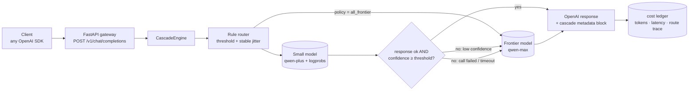
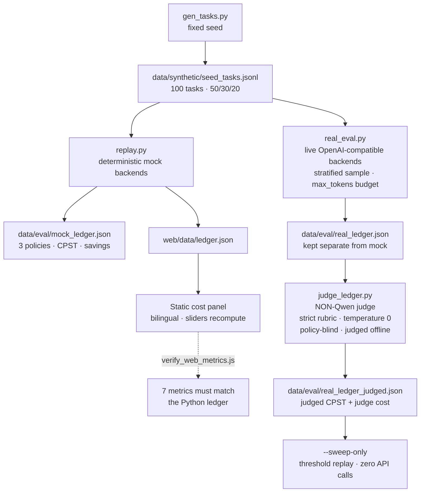
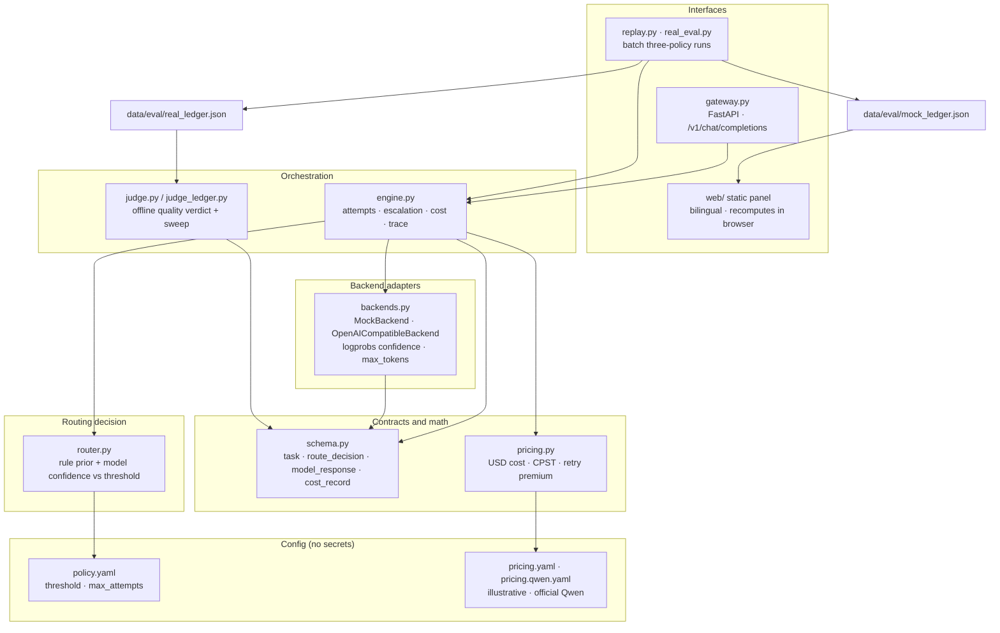

# When to Escalate

A runnable **cascade-inference** product demo: every task starts on a cheap small model, and a deterministic router escalates to a frontier model only when the small answer fails or its confidence falls below a threshold. The repo ships an OpenAI-compatible gateway and a static cost panel that compares three architectures on the same task flow.

- **North-star metric**: Cost per Successful Task (`CPST`), including retry and escalation spend.
- **Three policies**: `all_frontier`, `cascade`, `all_small`.
- **Mock-first**: a deterministic ledger runs fully offline; real backends are wired through environment variables.
- **Zero keys by default**: the panel is static and bilingual (`zh` / `en`), ready for GitHub Pages.
- **One gateway**: `POST /v1/chat/completions` returns a standard OpenAI response plus a `cascade` routing/cost block.

> **All default numbers are MOCK.** They come from a deterministic mock backend, not from measured model output. Fifty-task stratified real-backend evaluations (Bailian qwen-plus/qwen-flash → qwen-max, non-Qwen judge, threshold sweeps) live in `data/eval/real_ledger*.json` and are reported in [docs/03-eval.md](docs/03-eval.md#8-真实后端评测f255-条分层样本). Results are **model- and operating-point-dependent**: without an output limit the qwen-plus cascade loses 8.6%; one "≤120 words" instruction brings a matched 80% success point to $0.018454, **7.0% cheaper** than all-frontier. At official Bailian prices, qwen-flash cuts small-model spend another 46.2%, but judged small-model success falls from 44% to 10%; its only matched-80% sweep point is full escalation at $0.019817, **5.0% more** than all-frontier. Savings depend on price, output length, answer quality, task mix and routing signal—not on token price alone. Prices in `cascade/configs/pricing.yaml` are illustrative examples, not vendor quotes.

## Architecture

Online request path — every task tries the small model first; escalation is traceable:



Offline evaluation path — mock first, real backends optional, judge separate:



The mock ledger is the default everywhere; the real ledger is opt-in evidence and never merged into the mock tables.

### Component architecture

Layers only depend downward; the escalation decision lives in exactly one place (`router.py` + `engine.py`), so a fixed policy can never silently gain a routing rule.



Key invariants the diagram encodes:

- **One decision point.** Only `router.py` + `engine.py` decide to escalate; the gateway, the replay and the real eval all call the same engine.
- **Contracts before behaviour.** `schema.py` validates every `task`, `route_decision`, `model_response` and `cost_record`, so an invalid trace fails loudly instead of skewing a metric.
- **Adapters are swappable.** `MockBackend` makes the whole pipeline offline and deterministic; `OpenAICompatibleBackend` adds logprobs confidence and an output budget for real backends.
- **Evaluation is separate from serving.** The judge and the threshold sweep read a finished ledger and never touch the request path.

## Quick start (offline, no GPU, no API key)

```bash
python3 -m pip install jsonschema pyyaml pytest fastapi httpx uvicorn

# 1. Rebuild the synthetic task flow and the three-policy mock ledger.
python3 cascade/src/gen_tasks.py
python3 cascade/src/replay.py

# 2. Run the Python test suite.
python3 -m pytest cascade/tests/ -q

# 3. Check that the browser metric formulas match the Python ledger.
node cascade/tests/verify_web_metrics.js

# 4. Preview the static panel at http://127.0.0.1:8765/
python3 -m http.server 8765 --directory web
```

`replay.py` rewrites `data/eval/mock_ledger.{json,md}` and `web/data/ledger.json`; the panel re-simulates all three policies client-side from the raw per-attempt responses.

### Mock ledger (100 tasks, illustrative prices)

| Policy | Total cost | CPST | Success | Escalation | Savings vs frontier |
|---|---|---|---|---|---|
| `all_frontier` | $0.235848 | $0.002378 | 98% | 0% | 0% |
| `cascade` | $0.118222 | $0.001184 | 99% | 29% | 49.87% |
| `all_small` | $0.011840 | $0.000113 | 93% | 0% | 94.98% |

The cascade cuts spend by roughly half while keeping success at or above the all-frontier baseline. This is a **mock** result; see [docs/03-eval.md](docs/03-eval.md) for the exact metric definitions.

## OpenAI-compatible gateway

The gateway resolves two OpenAI-compatible endpoints from environment variables (never from the repo):

```bash
export CASCADE_SMALL_BASE_URL=http://127.0.0.1:6006/v1
export CASCADE_SMALL_MODEL=wte-small
export CASCADE_FRONTIER_BASE_URL=https://api.example.com/v1
export CASCADE_FRONTIER_MODEL=frontier-model
export CASCADE_FRONTIER_API_KEY=...   # secret, never commit

uvicorn cascade.src.gateway:app --port 8000
```

**Alibaba Bailian (Qwen) shortcut** — Bailian is fully OpenAI-compatible, so a
single `DASHSCOPE_API_KEY` is enough to serve a `qwen-turbo` / `qwen-max`
cascade via `https://dashscope.aliyuncs.com/compatible-mode/v1`:

```bash
export DASHSCOPE_API_KEY=sk-...       # from the Bailian console, never commit

uvicorn cascade.src.gateway:app --port 8000
```

Override the default models with `CASCADE_SMALL_MODEL` / `CASCADE_FRONTIER_MODEL`
(e.g. `qwen-flash`, `qwen-max`), or call `bailian_backends()` from
`cascade/src/backends.py` directly. Real-run costs must use a matching price card:
`cascade/configs/pricing.qwen-flash.yaml` records official Bailian list prices for
qwen-flash (input ≤128K tier) and qwen-max, converted at 7.2 CNY/USD.
`DASHSCOPE_API_KEY` also works as the fallback key for both roles when using the
full `CASCADE_*` configuration.

Real backends request token log-probabilities and use `exp(mean logprob)` as the
model-reported confidence for escalation; set `CASCADE_LOGPROBS=0` to disable it
and fall back to the rule-based prior.

Call it like any OpenAI chat endpoint:

```bash
curl -s http://127.0.0.1:8000/v1/chat/completions \
  -H 'Content-Type: application/json' \
  -d '{"model":"cascade","messages":[{"role":"user","content":"今天东莞天气怎么样？需要带伞吗？"}]}'
```

The response keeps the standard `choices` / `usage` fields and adds:

```json
{
  "cascade": {
    "policy": "cascade",
    "kind": "simple",
    "success": true,
    "confidence": 0.9188,
    "escalated": false,
    "attempts": 1,
    "cost_usd": 0.000063,
    "decisions": [{"selected_model": "small", "escalated": false, "reason": "..."}]
  }
}
```

Notes:

- `GET /healthz` reports policy, backend roles, or a clear `503` when endpoints are missing.
- Prompt length maps to a task kind (`simple` / `medium` / `complex`) so a stateless OpenAI client can use the same router.
- Streaming is not supported (`stream: true` returns a `400` OpenAI-style error).
- Transport errors become failed attempts, not exceptions; the engine escalates and CPST includes the wasted spend. Errors never echo stack traces, endpoints or keys.

## Panel

`web/` is a zero-build static site. It loads `web/data/ledger.json`, renders:

- three-policy switch with a per-task routing chain (`small → frontier`) and the escalation reason;
- live totals for total cost, CPST, success, escalation, latency and savings;
- sliders for confidence threshold, small/frontier prices and traffic mix, recomputed in the browser;
- a reset-to-defaults action;
- Chinese / English switch (`?lang=zh` or `?lang=en`);
- optional **online mode** that connects to a self-hosted gateway. The offline replay stays available if the connection fails.

All metric math lives in `web/js/metrics.js` and is verified against the Python ledger by `cascade/tests/verify_web_metrics.js`, so the panel cannot silently drift from the evaluation.

## Repository layout

```
cascade/
  configs/        pricing.yaml (example prices), policy.yaml (threshold / attempts / mix)
  src/            schema, pricing, router, engine, backends, gateway, replay
  tests/          Python tests + verify_web_metrics.js
data/
  schema/         exported JSON Schemas
  templates/      synthetic task templates
  synthetic/      deterministic seed task flow
  eval/           mock ledger (JSON + Markdown)
web/              static cost panel (HTML/CSS/JS, no build step)
docs/             three short articles (Chinese; English under docs/en/)
private/          local harness state and internal spec (gitignored, not published)
```

## Docs

- [docs/01-why-cascade.md](docs/01-why-cascade.md) — why cascade inference (Chinese)
- [docs/02-method.md](docs/02-method.md) — contracts, routing, engine, gateway (Chinese)
- [docs/03-eval.md](docs/03-eval.md) — metrics, mock ledger, evidence, limits (Chinese)
- English versions: [docs/en/01-why-cascade.md](docs/en/01-why-cascade.md), [docs/en/02-method.md](docs/en/02-method.md), [docs/en/03-eval.md](docs/en/03-eval.md)

## Status

| Milestone | State | Notes |
|---|---|---|
| M1 — ledger & routing pure functions | Verified | 100-task mock ledger, cost/CPST tests |
| M2 — engine & service | Locally verified | Engine, fallback and gateway tested with in-process fake/mock backends |
| F2.5 — real-backend eval | **Evaluated, model-dependent** | 50 stratified tasks, Bailian qwen-plus/qwen-flash → qwen-max, non-Qwen judge. qwen-plus loses 8.6% at baseline; a "≤120 words" instruction reaches a matched 80% success point **7.0% cheaper**. Officially priced qwen-flash lowers `S/F` to 0.050, but small-model success falls 44%→10% and avoidable share to 0.218; the only matched-80% point is full escalation at $0.019817, **5.0% more** than all-frontier. Larger-sample confirmation is still needed |
| M3 — panel | Verified locally | Browser checks for policy switch, live recompute, i18n and online mode |
| F3.5 — public deployment | Pending | `deploy.yml` is included; a live Pages URL needs repository/Pages permission |

## Scope

Synthetic/public tasks only. No real personal data, no secrets. Learned routing, multi-agent orchestration and real data ingestion are out of scope for this iteration.

## License

Apache-2.0. See [LICENSE](LICENSE).
