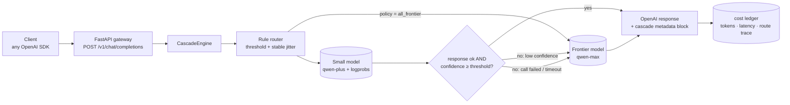
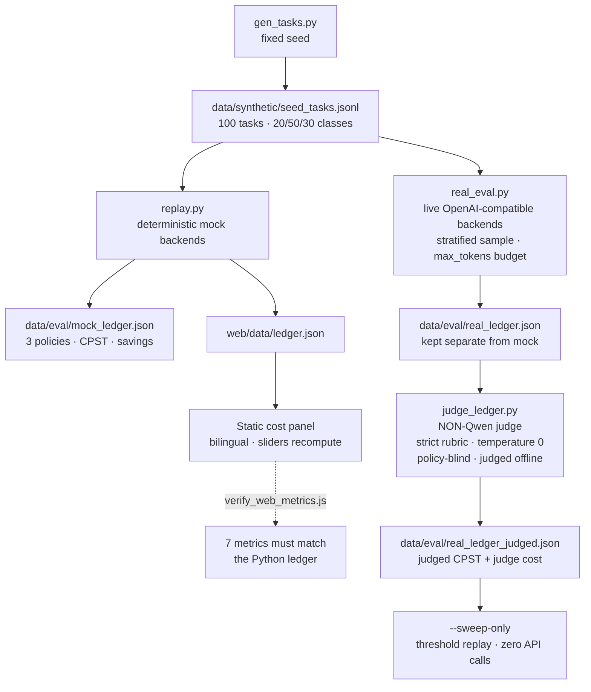
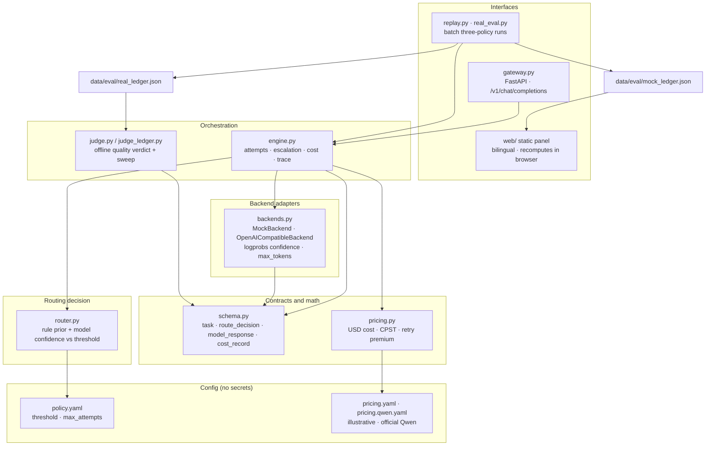

# When to Escalate

**When to Escalate** is the routing infrastructure for an **always-on agent**.
An always-on agent makes thousands of low-stakes decisions a day — sensing a
notification, reading the weather, drafting a reply — that should never pay for
a frontier model, and a few irreversible ones — sending, paying, deleting —
that must. The question that makes or breaks the product is not "which model is
best" but **when to pay for the expensive one**.

The repo answers it in two layers:

- a **personal policy layer** (`personal_policy.py`) that buckets every decision
  point by consequence, latency and load, applies hard constraints (privacy,
  device state, budget), and decides — *before any model call* — which model
  tier is even allowed;
- a **cascade engine** (`engine.py` / `router.py`) that, within the buckets
  allowed to escalate, tries the cheap small model first and upgrades to the
  frontier model only when the answer fails or its confidence falls below a
  threshold.

It ships an OpenAI-compatible gateway and a static, bilingual cost panel that
compares three architectures on the same task flow.

- **North-star metric**: Cost per Successful Task (`CPST`), including retry and escalation spend.
- **Three policies**: `all_frontier`, `cascade`, `all_small`.
- **Mock-first**: a deterministic ledger runs fully offline; real backends are wired through environment variables.
- **Zero keys by default**: the panel is static and bilingual (`zh` / `en`), ready for GitHub Pages.
- **One gateway**: `POST /v1/chat/completions` returns a standard OpenAI response plus a `cascade` routing/cost block.

> The panel opens with measured results (3-run mean from committed judged ledgers, see the "Real measured result" section below); the interactive sandbox is mock-labelled throughout. Prices in `cascade/configs/pricing.yaml` are illustrative examples, not vendor quotes. Real-model numbers are sample- and operating-point dependent; judge = external non-Qwen, see [docs/03-eval.md](docs/03-eval.md).

## Always-on agent decision policy

An always-on agent does not have one task type — it has a steady stream of
decision points with very different stakes. The personal policy layer
([`cascade/src/personal_policy.py`](cascade/src/personal_policy.py),
[`cascade/configs/personal_policy.yaml`](cascade/configs/personal_policy.yaml))
resolves one bucket per decision point, **before any model call**, so cost and
risk stay predictable. It is a pure function: no model, no network.

Resolution order (first match wins):

1. **Hard constraints** — privacy, device state, budget run first and never
   enter the quality-routing path.
2. **Consequence** — irreversible write > reversible write > suggestion > read.
3. **Latency** — background work falls back to the batch bucket.
4. **Classifier uncertainty** — when the consequence classifier reports
   confidence below `consequence_confidence_floor` (0.80), the decision steps
   up one bucket (read → suggest → reversible → irreversible).

The six fixed buckets:

| Bucket | Typical decision | Model | Verifier | Escalate | SLO |
|---|---|---|---|---|---|
| `B0_sense` | sense / filter a notification | `none` | rule | no | 200 ms |
| `B1_read` | interactive read-only answer | `small` | none | no | 2 s |
| `B2_draft` | suggestion / draft the user inspects | `small` | schema | on failure | 3 s |
| `B3_act_reversible` | reminder, tag, local state change | `small` | tool_result | on failure | 5 s |
| `B4_act_irreversible` | send, pay, delete | `frontier` | human | no | 10 s |
| `B5_background` | digest / archive, low consequence | `small` | sample | no | 60 s (batch) |

Only `B2_draft` and `B3_act_reversible` are allowed to escalate small →
frontier; every other bucket keeps a fixed model. A bucket is **promoted** to
quality routing only when *all* telemetry gates pass (`check_promotion`):
≥ 300 decisions, verifier coverage ≥ 0.90, small-model accept rate ≥ 0.80,
cost reduction ≥ 0.10, and error-rate ratio ≤ 1.20.

Hard constraints that can override the bucket:

- **`local_only`** — data never leaves the device: use the local model, never
  escalate; queue if the local model is unavailable.
- **`user_absent_irreversible`** — an irreversible action while the user is
  away is queued for confirmation.
- **`degraded_device`** — low battery or weak network defers paid work to the
  background bucket (sensing is preserved).
- **`budget_exhausted`** — only `B0` / `B1` / `B2` run; everything else is
  deferred.

### The agent's verifier is user behaviour

For an always-on agent there is no separate test harness: the verifier is what
the user does next. Decision telemetry
([`cascade/src/telemetry.py`](cascade/src/telemetry.py)) records one JSONL line
per decision point with a fixed 27-field contract. The outcome field matters
most — without `user_edited` and `user_undone`, an always-on agent has no
verifier at all:

- outcomes: `pending`, `user_accepted`, `user_edited`, `user_undone`,
  `ignored`, `failed`;
- `summarize_events()` reports per-bucket accept rate, undo rate, error rate,
  average cost and average latency;
- these bucket-level numbers feed the promotion gates above.

> The policy layer and telemetry are currently **offline and simulated**.
> `replay_decisions.py`
> ([`data/telemetry/replay_summary.md`](data/telemetry/replay_summary.md))
> proves the buckets, constraints and telemetry add up to usable numbers from
> fixed priors — outcomes, tokens and latencies are synthetic, and prices are
> illustrative. The layer is **not yet wired into the live gateway**;
> `gateway.py` / `engine.py` today serve the cascade engine directly. See
> [docs/02-method.md](docs/02-method.md) for the full contract.

## Architecture

The diagrams below describe the **cascade engine layer** — the path that runs
*inside* a bucket the personal policy layer has allowed to escalate. The policy
layer decides *whether* a decision may reach this engine at all; the engine
decides *which model* within that bucket.

Online request path — every task tries the small model first; escalation is traceable:



Offline evaluation path — mock first, real backends optional, judge separate:



The mock ledger is the default everywhere; the real ledger is opt-in evidence and never merged into the mock tables.

### Component architecture

Layers only depend downward; the escalation decision lives in exactly one place (`router.py` + `engine.py`), so a fixed policy can never silently gain a routing rule.



Key invariants the diagram encodes:

- **One decision point.** Only `router.py` + `engine.py` decide to escalate; the gateway, the replay and the real eval all call the same engine.
- **Contracts before behaviour.** `schema.py` validates every `task`, `route_decision`, `model_response` and `cost_record`, so an invalid trace fails loudly instead of skewing a metric.
- **Adapters are swappable.** `MockBackend` makes the whole pipeline offline and deterministic; `OpenAICompatibleBackend` adds logprobs confidence and an output budget for real backends.
- **Evaluation is separate from serving.** The judge and the threshold sweep read a finished ledger and never touch the request path.
- **Policy gates the engine.** `personal_policy.py` resolves the bucket and hard constraints before the engine runs; the engine only escalates within an allowed, routable bucket. The policy layer is currently offline/simulated (see above).

## Quick start (offline, no GPU, no API key)

```bash
python3 -m pip install jsonschema pyyaml pytest fastapi httpx uvicorn numpy scikit-learn

# 1. Rebuild the synthetic task flow and the three-policy mock ledger.
python3 cascade/src/gen_tasks.py
python3 cascade/src/replay.py

# 2. Run the Python test suite.
python3 -m pytest cascade/tests/ -q

# 3. Check that the browser metric formulas match the Python ledger.
node cascade/tests/verify_web_metrics.js

# 4. Preview the static panel at http://127.0.0.1:8765/
python3 -m http.server 8765 --directory web
```

`replay.py` rewrites `data/eval/mock_ledger.{json,md}` and `web/data/ledger.json`; the panel re-simulates all three policies client-side from the raw per-attempt responses. The panel's headline real-results view is generated from the committed judged ledgers by `python3 cascade/src/build_web_real.py` → `web/data/real_summary.json`, and its structure is checked by `verify_web_metrics.js`.

### Real measured result (3-run mean, real backends)

`qwen-plus` (brief system prompt) → `qwen-max`, verifier-first escalation, threshold 0.85, max_tokens 1024, on 50 stratified tasks, judged by an external non-Qwen judge. Three independent repeats; numbers below are the mean with the per-run success range. **This is a measured trade-off, not "same success, cheaper."**

| Policy | Serving cost | Serving CPST | Success (range) | % of frontier | CPST incl. judge |
|---|---|---|---|---|---|
| `all_frontier` | $0.015482 | $0.000280 | 91.3% (90–92) | 100% | $0.000723 |
| `cascade` | $0.005660 | $0.000103 | 87.3% (86–88) | 36.6% | $0.000519 |
| `all_small` | $0.001467 | $0.000024 | 80.7% (80–82) | 9.5% | $0.000500 |

Cascade serves at **36.6% of frontier cost for a 4.0 pp success loss** (87.3% vs 91.3%). All-in CPST (including the offline judge estimate) is $0.000519 vs $0.000723 for frontier. Real-model numbers are sample-, model- and operating-point-dependent; the full evidence and per-run breakdown are in [docs/03-eval.md](docs/03-eval.md), and the panel renders this table live from `web/data/real_summary.json`.

### Deterministic mock baseline (100 tasks, illustrative prices)

This is the offline, reproducible sandbox the panel re-simulates client-side; it is **mock** and is not the headline result above.

| Policy | Total cost | CPST | Success | Escalation | Savings vs frontier |
|---|---|---|---|---|---|
| `all_frontier` | $0.235848 | $0.002378 | 98% | 0% | 0% |
| `cascade` | $0.118222 | $0.001184 | 99% | 29% | 49.87% |
| `all_small` | $0.011840 | $0.000113 | 93% | 0% | 94.98% |

The mock cascade cuts spend by roughly half while keeping success at or above the all-frontier baseline; see [docs/03-eval.md](docs/03-eval.md) for the exact metric definitions.

## OpenAI-compatible gateway

The gateway resolves two OpenAI-compatible endpoints from environment variables (never from the repo):

```bash
export CASCADE_SMALL_BASE_URL=http://127.0.0.1:6006/v1
export CASCADE_SMALL_MODEL=wte-small
export CASCADE_FRONTIER_BASE_URL=https://api.example.com/v1
export CASCADE_FRONTIER_MODEL=frontier-model
export CASCADE_FRONTIER_API_KEY=...   # secret, never commit

uvicorn cascade.src.gateway:app --port 8000
```

**Alibaba Bailian (Qwen) shortcut** — Bailian is fully OpenAI-compatible, so a
single `DASHSCOPE_API_KEY` is enough to serve a `qwen-turbo` / `qwen-max`
cascade via `https://dashscope.aliyuncs.com/compatible-mode/v1`:

```bash
export DASHSCOPE_API_KEY=sk-...       # from the Bailian console, never commit

uvicorn cascade.src.gateway:app --port 8000
```

Override the default models with `CASCADE_SMALL_MODEL` / `CASCADE_FRONTIER_MODEL`
(e.g. `qwen-flash`, `qwen-max`), or call `bailian_backends()` from
`cascade/src/backends.py` directly. Real-run costs must use a matching price card:
`cascade/configs/pricing.qwen-flash.yaml` records official Bailian list prices for
qwen-flash (input ≤128K tier) and qwen-max, converted at 7.2 CNY/USD.
`DASHSCOPE_API_KEY` also works as the fallback key for both roles when using the
full `CASCADE_*` configuration.

Real backends request token log-probabilities and use `exp(mean logprob)` as the
model-reported confidence for escalation; set `CASCADE_LOGPROBS=0` to disable it
and fall back to the rule-based prior.

Call it like any OpenAI chat endpoint:

```bash
curl -s http://127.0.0.1:8000/v1/chat/completions \
  -H 'Content-Type: application/json' \
  -d '{"model":"cascade","messages":[{"role":"user","content":"今天东莞天气怎么样？需要带伞吗？"}]}'
```

The response keeps the standard `choices` / `usage` fields and adds:

```json
{
  "cascade": {
    "policy": "cascade",
    "kind": "simple",
    "success": true,
    "confidence": 0.9188,
    "escalated": false,
    "attempts": 1,
    "cost_usd": 0.000063,
    "decisions": [{"selected_model": "small", "escalated": false, "reason": "..."}]
  }
}
```

Notes:

- `GET /healthz` reports policy, backend roles, or a clear `503` when endpoints are missing.
- Prompt length maps to a task kind (`simple` / `medium` / `complex`) so a stateless OpenAI client can use the same router.
- Streaming is not supported (`stream: true` returns a `400` OpenAI-style error).
- Transport errors become failed attempts, not exceptions; the engine escalates and CPST includes the wasted spend. Errors never echo stack traces, endpoints or keys.

## Panel

`web/` is a zero-build static site. It loads `web/data/ledger.json`, renders:

- three-policy switch with a per-task routing chain (`small → frontier`) and the escalation reason;
- live totals for total cost, CPST, success, escalation, latency and savings;
- sliders for confidence threshold, small/frontier prices and traffic mix, recomputed in the browser;
- a reset-to-defaults action;
- Chinese / English switch (`?lang=zh` or `?lang=en`);
- optional **online mode** that connects to a self-hosted gateway. The offline replay stays available if the connection fails.

All metric math lives in `web/js/metrics.js` and is verified against the Python ledger by `cascade/tests/verify_web_metrics.js`, so the panel cannot silently drift from the evaluation.

## Repository layout

```
cascade/
  configs/        pricing.yaml (example prices), policy.yaml (threshold / attempts / mix),
                  personal_policy.yaml (B0–B5 buckets + hard constraints for the agent)
  src/            schema, pricing, router, engine, backends, gateway, replay,
                  personal_policy, telemetry, replay_decisions
  tests/          Python tests + verify_web_metrics.js
data/
  schema/         exported JSON Schemas
  templates/      synthetic task templates
  synthetic/      deterministic seed task flow
  eval/           mock ledger (JSON + Markdown)
  telemetry/      simulated decision replay (events + per-bucket summary)
web/              static cost panel (HTML/CSS/JS, no build step)
docs/             three short articles (Chinese; English under docs/en/)
private/          local harness state and internal spec (gitignored, not published)
```

## Docs

- [docs/01-why-cascade.md](docs/01-why-cascade.md) — the always-on agent unit-economics problem (Chinese)
- [docs/02-method.md](docs/02-method.md) — agent decision policy, contracts, routing, engine, gateway (Chinese)
- [docs/03-eval.md](docs/03-eval.md) — metrics, mock ledger, evidence, limits (Chinese)
- English versions: [docs/en/01-why-cascade.md](docs/en/01-why-cascade.md), [docs/en/02-method.md](docs/en/02-method.md), [docs/en/03-eval.md](docs/en/03-eval.md)

## Status

| Milestone | State | Notes |
|---|---|---|
| M1 — ledger & routing pure functions | Verified | 100-task mock ledger, cost/CPST tests |
| M2 — engine & service | Locally verified | Engine, fallback and gateway tested with in-process fake/mock backends |
| F2.5 — real-backend eval | **PASSING under revised trade-off criterion (2026-11-19)** | Three identical verifier-first runs on the same 50 stratified tasks (qwen-plus brief → qwen-max, external non-Qwen judge, 16% escalation) score 88% / 86% / 88% (mean 87.3%) versus same-round frontier 92% / 92% / 90% (mean 91.3%), a stable 4.0 pp loss (paired −2/−3/−1 tasks). Serving cost is 36.6% of frontier ($0.005660 vs $0.015482, −63.4%), with `judge_failed=0` in all rounds. The original "same success, lower CPST" criterion is explicitly waived: all gain over all-small comes from refusal tasks (8.33/10 vs 5/10), frontier-required is identical (10.33/15), and strict mode reaches 94.0% only at ~98.5% of frontier cost. Including judge cost, all-in CPST is 28% below frontier but slightly above all-small ($0.000519 vs $0.000500). Required wording: "about 37% of frontier cost for a 4 pp success loss", never "same success, cheaper". See `docs/en/03-eval.md` §8.17–8.18. |
| M3 — panel | Verified locally | Browser checks for policy switch, live recompute, i18n and online mode |
| F3.5 — public deployment | Pending | `deploy.yml` is included; a live Pages URL needs repository/Pages permission |

## Scope

Synthetic/public tasks only. No real personal data, no secrets. Learned routing, multi-agent orchestration and real data ingestion are out of scope for this iteration.

## License

Apache-2.0. See [LICENSE](LICENSE).
