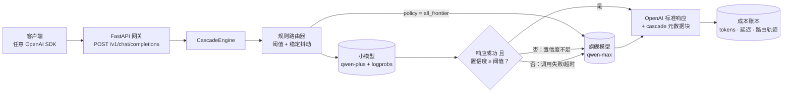
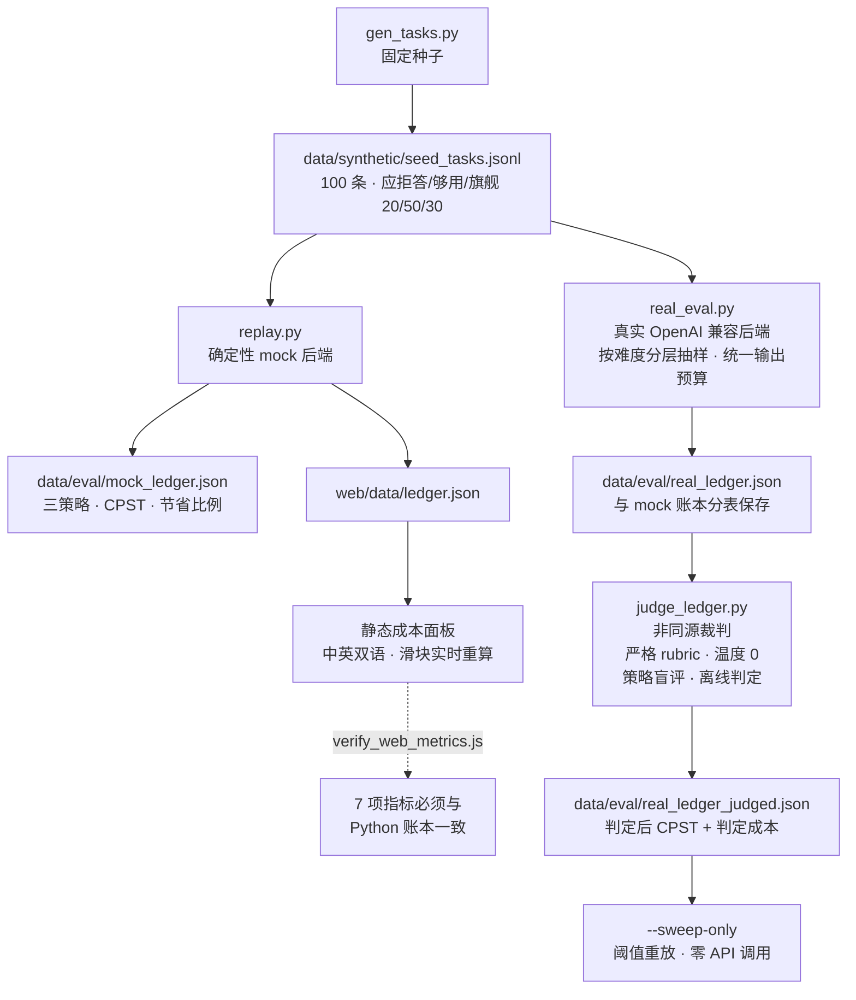
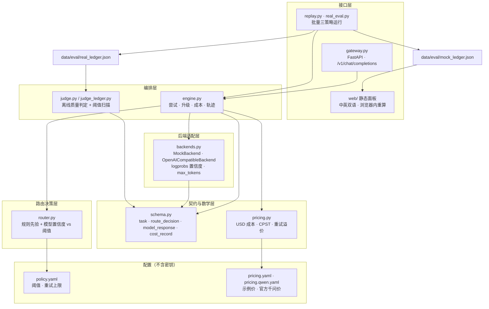

# When to Escalate —— 何时该升级

**When to Escalate** 是面向 **Always-on Agent** 的路由基础设施。一个常驻运行的 agent 每天要做成千上万个低风险决策——过滤通知、查天气、起草回复——这些绝不该为旗舰模型付费；同时又有少数不可逆动作——发送、支付、删除——必须用旗舰。决定产品能否成立的问题不是“哪个模型最好”，而是**什么时候该为更贵的模型付费**。

仓库用两层来回答这个问题：

- **个人策略层**（`personal_policy.py`）：按后果、时延、认知负载把每个决策点分桶，施加硬约束（隐私、设备状态、预算），在**任何模型调用之前**就决定该决策点允许使用哪一档模型；
- **级联引擎**（`engine.py` / `router.py`）：在被允许升级的桶内，先让低成本小模型尝试，只有当答案失败或置信度低于阈值时才升级到旗舰模型。

仓库同时提供 OpenAI 兼容网关与一个静态、中英双语的成本面板，在同一任务流上对比三种架构策略。

- **北极星指标**：Cost per Successful Task（`CPST`），把失败重试与升级花费都算进去。
- **三种策略**：`all_frontier`、`cascade`、`all_small`。
- **mock 优先**：确定性账本可完全离线运行；真实后端通过环境变量接入。
- **默认零密钥**：面板纯静态、中英双语（`zh` / `en`），可直接部署到 GitHub Pages。
- **一个网关**：`POST /v1/chat/completions` 返回标准 OpenAI 响应，并附加 `cascade` 路由与成本信息。

> 面板顶部展示实测结果（3 轮判定账本均值，见下方"实测结果"小节）；下方 mock 沙盒可交互重算，明确标注为非实测。`cascade/configs/pricing.yaml` 中的价格是示例值，不代表任何厂商报价。真实数字取决于模型与工作点；裁判为外部非同源，详见 [docs/03-eval.md](docs/03-eval.md)。

## Always-on Agent 决策策略

常驻 agent 不是只有一种任务，而是一条风险差异很大的决策点流。个人策略层
（[`cascade/src/personal_policy.py`](cascade/src/personal_policy.py)、
[`cascade/configs/personal_policy.yaml`](cascade/configs/personal_policy.yaml)）
为每个决策点解析出一个桶，**在任何模型调用之前**，让成本与风险保持可预测。它是纯函数：不调模型、不碰网络。

解析顺序（先匹配先生效）：

1. **硬约束** —— 隐私、设备状态、预算最先执行，且永不进入质量路由路径。
2. **后果** —— 不可逆写 > 可逆写 > 建议 > 读取。
3. **时延** —— 后台工作回落到批处理桶。
4. **分类器不确定** —— 当后果分类器置信度低于 `consequence_confidence_floor`（0.80）时，决策向上提一档桶（读取 → 建议 → 可逆 → 不可逆）。

六个固定桶：

| 桶 | 典型决策 | 模型 | 验证器 | 升级 | SLO |
|---|---|---|---|---|---|
| `B0_sense` | 感知 / 过滤通知 | `none` | rule | 否 | 200 ms |
| `B1_read` | 交互式只读回答 | `small` | none | 否 | 2 s |
| `B2_draft` | 用户可检视的建议 / 草稿 | `small` | schema | 失败时 | 3 s |
| `B3_act_reversible` | 提醒、打标、本地状态变更 | `small` | tool_result | 失败时 | 5 s |
| `B4_act_irreversible` | 发送、支付、删除 | `frontier` | human | 否 | 10 s |
| `B5_background` | 低后果的摘要 / 归档 | `small` | sample | 否 | 60 s（批处理） |

只有 `B2_draft` 与 `B3_act_reversible` 被允许从小模型升级到旗舰；其余桶保持固定模型。一个桶只有在**全部**遥测门槛通过时才会被**晋升**到质量路由（`check_promotion`）：决策数 ≥ 300、验证器覆盖率 ≥ 0.90、小模型接受率 ≥ 0.80、成本降低 ≥ 0.10、错误率比值 ≤ 1.20。

可覆盖桶归属的硬约束：

- **`local_only`** —— 数据永不离开设备：使用本地模型、永不升级；本地模型不可用时排队。
- **`user_absent_irreversible`** —— 用户不在场时的不可逆动作排队等候确认。
- **`degraded_device`** —— 低电量或弱网把付费工作推迟到后台桶（感知类保留）。
- **`budget_exhausted`** —— 只放行 `B0` / `B1` / `B2`，其余推迟。

### agent 的验证器就是用户行为

常驻 agent 没有独立的测试环境：验证器就是用户接下来的动作。决策遥测
（[`cascade/src/telemetry.py`](cascade/src/telemetry.py)）为每个决策点记录一行 JSONL，固定 27 字段契约。其中 outcome 字段最关键——没有 `user_edited` 与 `user_undone`，常驻 agent 就根本没有验证器：

- 结果：`pending`、`user_accepted`、`user_edited`、`user_undone`、`ignored`、`failed`；
- `summarize_events()` 输出各桶的接受率、撤销率、错误率、平均成本与平均延迟；
- 这些桶级数字就是上面晋升门槛的输入。

> 策略层与遥测目前是**离线且模拟的**。`replay_decisions.py`
> （[`data/telemetry/replay_summary.md`](data/telemetry/replay_summary.md)）
> 用固定先验证明分桶、硬约束与遥测能汇总出可用的桶级数字——结果、token 数与延迟都是合成的，价格是示例值。该层**尚未接入在线网关**；当前 `gateway.py` / `engine.py` 直接服务级联引擎。完整契约见 [docs/02-method.md](docs/02-method.md)。

## 架构

下面的图描述的是**级联引擎层**——也就是在个人策略层允许升级的桶**内部**运行的路径。策略层决定一个决策点*能不能*进入这个引擎；引擎决定在该桶内*用哪个模型*。

在线请求链路——每个任务先走小模型，升级路径全程可追溯：



离线评测链路——mock 优先，真实后端可选，判定独立：



面板顶部默认展示实测结果（来自已提交的判定账本，经 `build_web_real.py` 生成 `real_summary.json`）；下方是标注清晰的 mock 交互沙盒。真实账本是按需产出的证据，与 mock 数字分开展示、各自标注。

### 组件架构

分层只向下依赖；升级决策只存在于 `router.py` + `engine.py` 一处，因此固定策略不可能悄悄获得路由规则。



这张图固化的四条不变量：

- **单点决策。** 只有 `router.py` + `engine.py` 决定是否升级；网关、mock 回放与真实评测调用的是同一个引擎。
- **契约先于行为。** `schema.py` 校验每个 `task` / `route_decision` / `model_response` / `cost_record`，非法轨迹会立刻报错，而不是污染指标。
- **适配器可替换。** `MockBackend` 让整条链路离线且确定性；`OpenAICompatibleBackend` 提供 logprobs 置信度与输出预算。
- **评测与在线服务隔离。** 判定与阈值扫描只读已完成的账本，永不进入请求路径。
- **策略门控引擎。** `personal_policy.py` 在引擎运行前解析桶与硬约束；引擎只在被允许且可路由的桶内升级。策略层目前是离线/模拟的（见上文）。

## 快速开始（离线，无 GPU、无 API Key）

```bash
python3 -m pip install jsonschema pyyaml pytest fastapi httpx uvicorn

# 1. 重建合成任务流与三策略 mock 账本
python3 cascade/src/gen_tasks.py
python3 cascade/src/replay.py

# 2. 跑 Python 测试
python3 -m pytest cascade/tests/ -q

# 3. 校验网页指标公式与 Python 账本一致
node cascade/tests/verify_web_metrics.js

# 4. 预览静态面板：http://127.0.0.1:8765/
python3 -m http.server 8765 --directory web
```

`replay.py` 会重写 `data/eval/mock_ledger.{json,md}` 与 `web/data/ledger.json`；面板利用逐次尝试的原始响应用户端重算三种策略。面板顶部的实测结果视图由已提交的判定账本经 `python3 cascade/src/build_web_real.py` 生成（`web/data/real_summary.json`），其结构由 `verify_web_metrics.js` 校验。

### 实测结果（3 轮均值，真实后端）

`qwen-plus`（简短系统提示）→ `qwen-max`，verifier-first 升级，阈值 0.85，max_tokens 1024，50 条分层抽样任务，由外部非同源裁判判定。三次独立重复；下表为均值，括号内为逐轮成功率区间。**这是实测的权衡，不是“同成功率更省钱”。**

| 策略 | 服务总成本 | 服务 CPST | 成功率（区间） | 占旗舰 | 含裁判 CPST |
|---|---|---|---|---|---|
| `all_frontier` | $0.015482 | $0.000280 | 91.3% (90–92) | 100% | $0.000723 |
| `cascade` | $0.005660 | $0.000103 | 87.3% (86–88) | 36.6% | $0.000519 |
| `all_small` | $0.001467 | $0.000024 | 80.7% (80–82) | 9.5% | $0.000500 |

级联以 **旗舰 36.6% 的服务成本，换取 4.0pp 的成功率差距**（87.3% vs 91.3%）。含离线裁判估算的全口径 CPST 为 $0.000519，旗舰为 $0.000723。真实模型数值取决于样本、模型与工作点；完整证据与逐轮明细见 [docs/03-eval.md](docs/03-eval.md)，面板也会从 `web/data/real_summary.json` 实时渲染此表。

### 确定性 mock 基线（100 条任务，示例定价）

这是面板用户端重算的离线、可复现沙盒；它是 **MOCK**，不是上面的实测结果。

| 策略 | 总成本 | CPST | 成功率 | 升级率 | 相对全旗舰节省 |
|---|---|---|---|---|---|
| `all_frontier` | $0.235848 | $0.002378 | 98% | 0% | 0% |
| `cascade` | $0.118222 | $0.001184 | 99% | 29% | 49.87% |
| `all_small` | $0.011840 | $0.000113 | 93% | 0% | 94.98% |

mock 级联把花费砍掉约一半，同时成功率不低于全旗舰；指标定义见 [docs/03-eval.md](docs/03-eval.md)。

## OpenAI 兼容网关

网关从环境变量读取两个 OpenAI 兼容端点（仓库内不保存任何 endpoint / key）：

```bash
export CASCADE_SMALL_BASE_URL=http://127.0.0.1:6006/v1
export CASCADE_SMALL_MODEL=wte-small
export CASCADE_FRONTIER_BASE_URL=https://api.example.com/v1
export CASCADE_FRONTIER_MODEL=frontier-model
export CASCADE_FRONTIER_API_KEY=...   # 密钥，绝不入库

uvicorn cascade.src.gateway:app --port 8000
```

**阿里云百炼（千问 Qwen）快捷方式** —— 百炼完全兼容 OpenAI 协议，只需一个
`DASHSCOPE_API_KEY` 即可通过 `https://dashscope.aliyuncs.com/compatible-mode/v1`
跑起 `qwen-turbo` / `qwen-max` 级联：

```bash
export DASHSCOPE_API_KEY=sk-...       # 在百炼控制台创建，绝不入库

uvicorn cascade.src.gateway:app --port 8000
```

可用 `CASCADE_SMALL_MODEL` / `CASCADE_FRONTIER_MODEL` 覆盖默认模型（如
`qwen-flash`、`qwen-max`），或直接调用
[cascade/src/backends.py](cascade/src/backends.py) 中的 `bailian_backends()`。
真实成本必须使用与模型匹配的定价表：`cascade/configs/pricing.qwen-flash.yaml`
记录了百炼 qwen-flash（输入 ≤128K 档）与 qwen-max 的官方标准价，按 7.2 CNY/USD
换算。使用完整 `CASCADE_*` 配置时，`DASHSCOPE_API_KEY` 也会作为两个角色密钥的回退值。

真实后端会请求 token logprobs，并用 `exp(平均 logprob)` 作为升级判定用的
模型自报置信度；设置 `CASCADE_LOGPROBS=0` 可关闭，退回规则先验。

像普通 OpenAI 客户端一样调用：

```bash
curl -s http://127.0.0.1:8000/v1/chat/completions \
  -H 'Content-Type: application/json' \
  -d '{"model":"cascade","messages":[{"role":"user","content":"今天东莞天气怎么样？需要带伞吗？"}]}'
```

响应保留标准 `choices` / `usage` 字段，并附加：

```json
{
  "cascade": {
    "policy": "cascade",
    "kind": "simple",
    "success": true,
    "confidence": 0.9188,
    "escalated": false,
    "attempts": 1,
    "cost_usd": 0.000063,
    "decisions": [{"selected_model": "small", "escalated": false, "reason": "..."}]
  }
}
```

说明：

- `GET /healthz` 返回策略、后端角色；端点未配置时返回清晰 `503`。
- 按 prompt 长度映射任务类型（`simple` / `medium` / `complex`），无状态客户端也能复用同一路由器。
- 不支持流式（`stream: true` 返回 OpenAI 风格 `400` 错误）。
- 传输失败会变成失败尝试而不是异常：引擎继续升级，浪费成本计入 CPST。错误信息不回显堆栈、endpoint 或密钥。

## 面板

`web/` 是零构建静态站点，读取 `web/data/ledger.json` 后展示：

- 三策略切换，逐任务显示路由链（`小模型 → 旗舰`）与升级原因；
- 总成本、CPST、成功率、升级率、延迟、节省比例的实时指标；
- 置信度阈值、大小模型单价、流量混合权重滑块，浏览器内实时重算；
- 一键恢复默认；
- 中英切换（`?lang=zh` / `?lang=en`）；
- 可选**在线模式**连接自托管网关；连接失败时保留离线回放。

所有指标公式集中在 `web/js/metrics.js`，并由 `cascade/tests/verify_web_metrics.js` 与 Python 账本逐项比对，防止面板与评测口径漂移。

## 目录

```
cascade/
  configs/        定价表 pricing.yaml（示例价）、策略 policy.yaml（阈值/重试/流量混合）、
                  personal_policy.yaml（agent 的 B0–B5 分桶 + 硬约束）
  src/            schema、pricing、router、engine、backends、gateway、replay、
                  personal_policy、telemetry、replay_decisions
  tests/          Python 测试 + verify_web_metrics.js
data/
  schema/         导出的 JSON Schema
  templates/      合成任务模板
  synthetic/      确定性种子任务流
  eval/           mock 账本（JSON + Markdown）
  telemetry/      模拟决策回放（事件 + 各桶汇总）
web/              静态成本面板（HTML/CSS/JS，无构建步骤）
docs/             三篇短文（中文；英文在 docs/en/）
private/          本地 harness 状态与内部规格（gitignore，不发布）
```

## 文档

- [docs/01-why-cascade.md](docs/01-why-cascade.md) —— Always-on Agent 的单位经济问题
- [docs/02-method.md](docs/02-method.md) —— agent 决策策略、数据契约、路由、引擎与网关
- [docs/03-eval.md](docs/03-eval.md) —— 指标、mock 账本、证据与边界
- 英文版：[docs/en/01-why-cascade.md](docs/en/01-why-cascade.md)、[docs/en/02-method.md](docs/en/02-method.md)、[docs/en/03-eval.md](docs/en/03-eval.md)

## 状态

| 里程碑 | 状态 | 说明 |
|---|---|---|
| M1 账本与路由纯函数 | 已验证 | 100 条 mock 任务账本，成本/CPST 单测 |
| M2 引擎与服务化 | 本地已验证 | 引擎、fallback、网关均用进程内 fake/mock 后端测试 |
| F2.5 真实后端评测 | **按修订权衡标准通过（2026-11-19）** | 同一 50 条分层任务上做 3 次 verifier-first 评测（qwen-plus brief → qwen-max、外部非同源裁判、16% 升级）：cascade 88% / 86% / 88%（均值 87.3%），同轮全旗舰 92% / 92% / 90%（均值 91.3%），稳定损失 4.0pp（配对 −2/−3/−1 条）；服务成本为旗舰的 36.6%（$0.005660 vs $0.015482，降低 63.4%），三轮 `judge_failed=0`。原“同成功率省钱”标准已明确豁免：相对全小模型的全部增益来自应拒答（8.33/10 vs 5/10），必须旗舰类相同（10.33/15），strict 需 98.5% 旗舰成本才达到 94.0%。含判定 CPST 低于旗舰 28%，但略高于 all_small（$0.000519 vs $0.000500）。对外固定表述为“约旗舰 37% 成本、低 4pp 成功率”，不得写“同成功率更省钱”。详见 `docs/03-eval.md` 8.17–8.18。 |
| M3 面板 | 本地已验证 | 浏览器检查策略切换、实时重算、双语与在线模式 |
| F3.5 公开部署 | 待完成 | 已提供 `deploy.yml`；线上 Pages URL 需要仓库/Pages 权限 |

## 范围

仅使用合成/公开任务；无真实个人数据、无密钥。学习型路由、多 agent 协作与真实数据接入不在本期范围。

## License

Apache-2.0，见 [LICENSE](LICENSE)。
