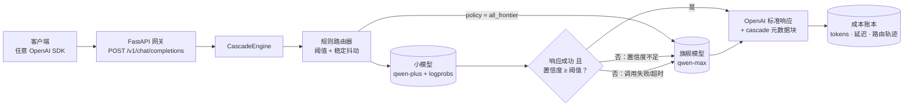
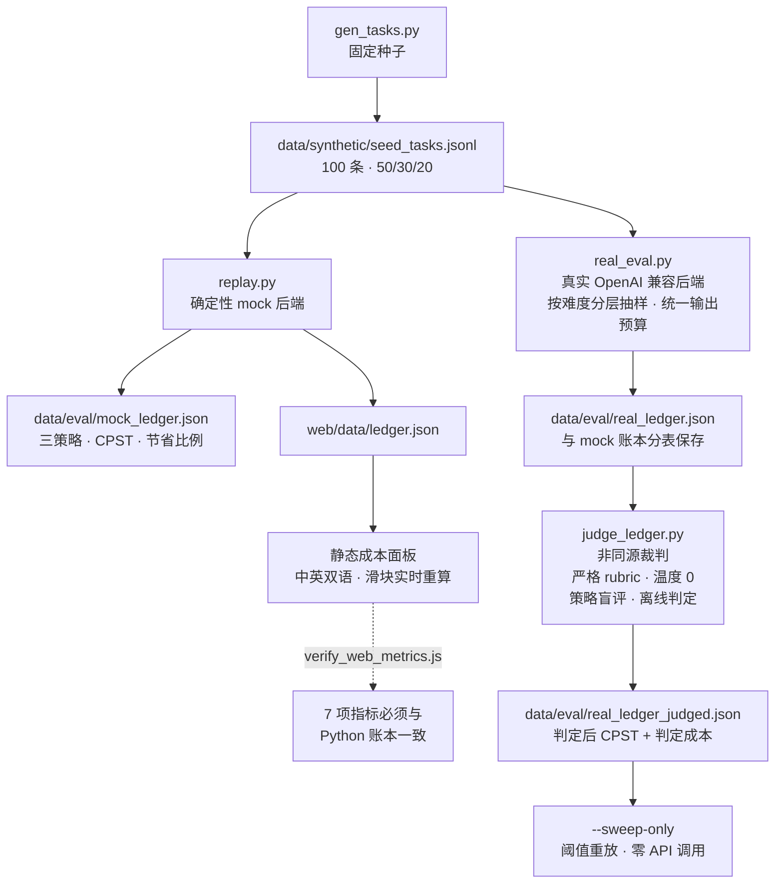
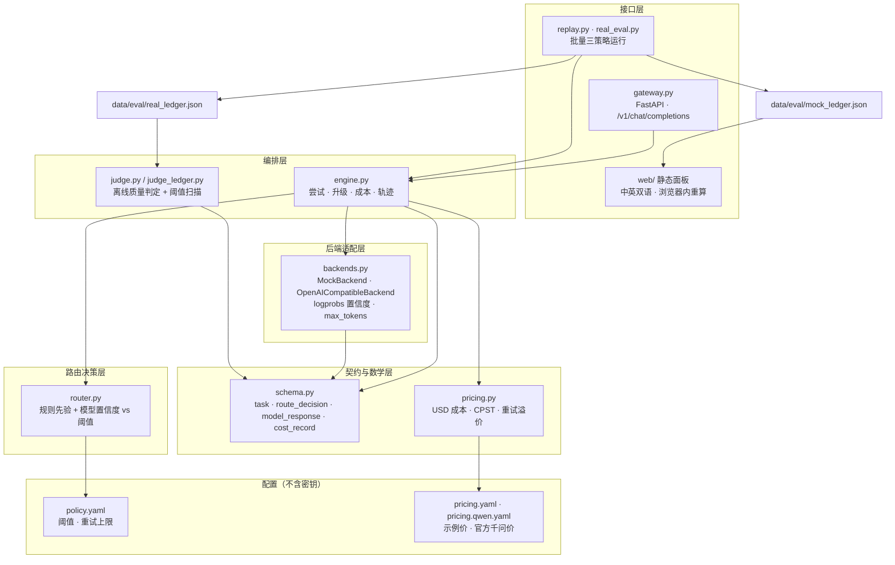

# When to Escalate —— 何时该升级

一个可运行、可服务化的**级联推理（cascade inference）产品**：每个任务先交给低成本小模型；当小模型失败，或路由置信度低于阈值时，才升级到旗舰模型。仓库同时提供 OpenAI 兼容网关与一个静态成本面板，在同一任务流上对比三种架构策略。

- **北极星指标**：Cost per Successful Task（`CPST`），把失败重试与升级花费都算进去。
- **三种策略**：`all_frontier`、`cascade`、`all_small`。
- **mock 优先**：确定性账本可完全离线运行；真实后端通过环境变量接入。
- **默认零密钥**：面板纯静态、中英双语（`zh` / `en`），可直接部署到 GitHub Pages。
- **一个网关**：`POST /v1/chat/completions` 返回标准 OpenAI 响应，并附加 `cascade` 路由与成本信息。

> **默认全部数字均为 MOCK。** 它们来自确定性 mock 后端，不是真实模型输出。50 条分层真实评测（百炼 qwen-plus/qwen-flash → qwen-max、非同源裁判、阈值扫描）在 `data/eval/real_ledger*.json`，报告见 [docs/03-eval.md](docs/03-eval.md#8-真实后端评测f255-条分层样本)。结论**取决于模型与工作点**：qwen-plus 不加输出限制时级联亏 8.6%；只给小模型加一句“≤120 词”指令，同等 80% 成功率下总花费 $0.018454，比全旗舰便宜 **7.0%**。按百炼官方价换用 qwen-flash 后，小模型花费再降 46.2%，但其判定成功率从 44% 降到 10%；唯一达到 80% 成功率的扫描点是 100% 升级，总花费 $0.019817，反而比全旗舰**贵 5.0%**。级联是否省钱由价差、输出长度、答案质量、任务分布与路由信号共同决定，不能只看 token 单价。`cascade/configs/pricing.yaml` 中的价格是示例值，不代表任何厂商报价。

## 架构

在线请求链路——每个任务先走小模型，升级路径全程可追溯：



离线评测链路——mock 优先，真实后端可选，判定独立：



所有默认展示都来自 mock 账本；真实账本是按需产出的证据，不与 mock 数字混排。

### 组件架构

分层只向下依赖；升级决策只存在于 `router.py` + `engine.py` 一处，因此固定策略不可能悄悄获得路由规则。



这张图固化的四条不变量：

- **单点决策。** 只有 `router.py` + `engine.py` 决定是否升级；网关、mock 回放与真实评测调用的是同一个引擎。
- **契约先于行为。** `schema.py` 校验每个 `task` / `route_decision` / `model_response` / `cost_record`，非法轨迹会立刻报错，而不是污染指标。
- **适配器可替换。** `MockBackend` 让整条链路离线且确定性；`OpenAICompatibleBackend` 提供 logprobs 置信度与输出预算。
- **评测与在线服务隔离。** 判定与阈值扫描只读已完成的账本，永不进入请求路径。

## 快速开始（离线，无 GPU、无 API Key）

```bash
python3 -m pip install jsonschema pyyaml pytest fastapi httpx uvicorn

# 1. 重建合成任务流与三策略 mock 账本
python3 cascade/src/gen_tasks.py
python3 cascade/src/replay.py

# 2. 跑 Python 测试
python3 -m pytest cascade/tests/ -q

# 3. 校验网页指标公式与 Python 账本一致
node cascade/tests/verify_web_metrics.js

# 4. 预览静态面板：http://127.0.0.1:8765/
python3 -m http.server 8765 --directory web
```

`replay.py` 会重写 `data/eval/mock_ledger.{json,md}` 与 `web/data/ledger.json`；面板利用逐次尝试的原始响应用户端重算三种策略。

### mock 账本（100 条任务，示例定价）

| 策略 | 总成本 | CPST | 成功率 | 升级率 | 相对全旗舰节省 |
|---|---|---|---|---|---|
| `all_frontier` | $0.235848 | $0.002378 | 98% | 0% | 0% |
| `cascade` | $0.118222 | $0.001184 | 99% | 29% | 49.87% |
| `all_small` | $0.011840 | $0.000113 | 93% | 0% | 94.98% |

级联把花费砍掉约一半，同时成功率不低于全旗舰。这是 **MOCK** 结果；指标定义与证据见 [docs/03-eval.md](docs/03-eval.md)。

## OpenAI 兼容网关

网关从环境变量读取两个 OpenAI 兼容端点（仓库内不保存任何 endpoint / key）：

```bash
export CASCADE_SMALL_BASE_URL=http://127.0.0.1:6006/v1
export CASCADE_SMALL_MODEL=wte-small
export CASCADE_FRONTIER_BASE_URL=https://api.example.com/v1
export CASCADE_FRONTIER_MODEL=frontier-model
export CASCADE_FRONTIER_API_KEY=...   # 密钥，绝不入库

uvicorn cascade.src.gateway:app --port 8000
```

**阿里云百炼（千问 Qwen）快捷方式** —— 百炼完全兼容 OpenAI 协议，只需一个
`DASHSCOPE_API_KEY` 即可通过 `https://dashscope.aliyuncs.com/compatible-mode/v1`
跑起 `qwen-turbo` / `qwen-max` 级联：

```bash
export DASHSCOPE_API_KEY=sk-...       # 在百炼控制台创建，绝不入库

uvicorn cascade.src.gateway:app --port 8000
```

可用 `CASCADE_SMALL_MODEL` / `CASCADE_FRONTIER_MODEL` 覆盖默认模型（如
`qwen-flash`、`qwen-max`），或直接调用
[cascade/src/backends.py](cascade/src/backends.py) 中的 `bailian_backends()`。
真实成本必须使用与模型匹配的定价表：`cascade/configs/pricing.qwen-flash.yaml`
记录了百炼 qwen-flash（输入 ≤128K 档）与 qwen-max 的官方标准价，按 7.2 CNY/USD
换算。使用完整 `CASCADE_*` 配置时，`DASHSCOPE_API_KEY` 也会作为两个角色密钥的回退值。

真实后端会请求 token logprobs，并用 `exp(平均 logprob)` 作为升级判定用的
模型自报置信度；设置 `CASCADE_LOGPROBS=0` 可关闭，退回规则先验。

像普通 OpenAI 客户端一样调用：

```bash
curl -s http://127.0.0.1:8000/v1/chat/completions \
  -H 'Content-Type: application/json' \
  -d '{"model":"cascade","messages":[{"role":"user","content":"今天东莞天气怎么样？需要带伞吗？"}]}'
```

响应保留标准 `choices` / `usage` 字段，并附加：

```json
{
  "cascade": {
    "policy": "cascade",
    "kind": "simple",
    "success": true,
    "confidence": 0.9188,
    "escalated": false,
    "attempts": 1,
    "cost_usd": 0.000063,
    "decisions": [{"selected_model": "small", "escalated": false, "reason": "..."}]
  }
}
```

说明：

- `GET /healthz` 返回策略、后端角色；端点未配置时返回清晰 `503`。
- 按 prompt 长度映射任务类型（`simple` / `medium` / `complex`），无状态客户端也能复用同一路由器。
- 不支持流式（`stream: true` 返回 OpenAI 风格 `400` 错误）。
- 传输失败会变成失败尝试而不是异常：引擎继续升级，浪费成本计入 CPST。错误信息不回显堆栈、endpoint 或密钥。

## 面板

`web/` 是零构建静态站点，读取 `web/data/ledger.json` 后展示：

- 三策略切换，逐任务显示路由链（`小模型 → 旗舰`）与升级原因；
- 总成本、CPST、成功率、升级率、延迟、节省比例的实时指标；
- 置信度阈值、大小模型单价、流量混合权重滑块，浏览器内实时重算；
- 一键恢复默认；
- 中英切换（`?lang=zh` / `?lang=en`）；
- 可选**在线模式**连接自托管网关；连接失败时保留离线回放。

所有指标公式集中在 `web/js/metrics.js`，并由 `cascade/tests/verify_web_metrics.js` 与 Python 账本逐项比对，防止面板与评测口径漂移。

## 目录

```
cascade/
  configs/        定价表 pricing.yaml（示例价）、策略 policy.yaml（阈值/重试/流量混合）
  src/            schema、pricing、router、engine、backends、gateway、replay
  tests/          Python 测试 + verify_web_metrics.js
data/
  schema/         导出的 JSON Schema
  templates/      合成任务模板
  synthetic/      确定性种子任务流
  eval/           mock 账本（JSON + Markdown）
web/              静态成本面板（HTML/CSS/JS，无构建步骤）
docs/             三篇短文（中文；英文在 docs/en/）
private/          本地 harness 状态与内部规格（gitignore，不发布）
```

## 文档

- [docs/01-why-cascade.md](docs/01-why-cascade.md) —— 为什么做级联推理
- [docs/02-method.md](docs/02-method.md) —— 数据契约、路由、引擎与网关
- [docs/03-eval.md](docs/03-eval.md) —— 指标、mock 账本、证据与边界
- 英文版：[docs/en/01-why-cascade.md](docs/en/01-why-cascade.md)、[docs/en/02-method.md](docs/en/02-method.md)、[docs/en/03-eval.md](docs/en/03-eval.md)

## 状态

| 里程碑 | 状态 | 说明 |
|---|---|---|
| M1 账本与路由纯函数 | 已验证 | 100 条 mock 任务账本，成本/CPST 单测 |
| M2 引擎与服务化 | 本地已验证 | 引擎、fallback、网关均用进程内 fake/mock 后端测试 |
| F2.5 真实后端评测 | **已评测，结论依赖模型** | 50 条分层任务，百炼 qwen-plus/qwen-flash → qwen-max，非同源裁判。qwen-plus 基线亏 8.6%，加“≤120 词”指令后同等 80% 成功率下**便宜 7.0%**。按官方价换用 qwen-flash 后 `S/F` 降至 0.050，但小模型成功率 44%→10%、可省份额降至 0.218；唯一同等 80% 成功率的点是 100% 升级，$0.019817，比全旗舰**贵 5.0%**。仍需扩样复核 |
| M3 面板 | 本地已验证 | 浏览器检查策略切换、实时重算、双语与在线模式 |
| F3.5 公开部署 | 待完成 | 已提供 `deploy.yml`；线上 Pages URL 需要仓库/Pages 权限 |

## 范围

仅使用合成/公开任务；无真实个人数据、无密钥。学习型路由、多 agent 协作与真实数据接入不在本期范围。

## License

Apache-2.0，见 [LICENSE](LICENSE)。
